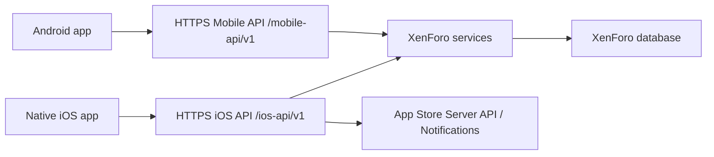

# Architecture

## Proposed System

The iOS app must consume a public HTTPS mobile API. It must not use XenForo database credentials or privileged API keys.

## iOS Layers
- `App`: SwiftUI app target, scenes, app lifecycle, environment selection.
- `Core`: configuration, API client, errors, logging, localization helpers.
- `Authentication`: login, registration, Google/Apple auth, token refresh, logout, Keychain storage.
- `Library`: catalog, search, authors, publishers, saved library, favorites, continue reading.
- `Reader`: PDFKit reader first, EPUB reader only after selecting a maintained legal dependency.
- `Downloads`: background-safe download coordinator, file validation, backup exclusion.
- `Community`: forums, topics, replies, messages, notifications, reporting, blocking.
- `Purchases`: StoreKit 2 products, purchase/restore, server verification.
- `Settings`: profile, privacy, support, account deletion, legal documents.

## Current Android Findings
- Native Compose application with routes for home, catalog, authors, publishers, requests, forum, members, messages, profile, notifications, premium, detail, reader, library, stats, and comments.
- Backend: Android uses `Ekitapligim/MobileApi` at `/mobile-api/v1/`. iOS uses standalone `Ekitapligim/IosApi` at `/ios-api/v1/`, delegating shared catalog/community controllers to MobileApi.
- Reader supports remote PDF/EPUB-like downloads, progress updates, access checks, daily read/download quotas, and Google Drive URL fallback.
- Premium exists through Google Play billing placeholder verification.
- Google authentication exists. iOS must add Sign in with Apple if Google auth remains.

## iOS Design Decisions
- Deployment target: iOS 17 for modern SwiftUI, Observation, StoreKit 2, and current App Store SDK compatibility.
- Networking: URLSession + async/await + typed endpoints.
- Sensitive storage: Keychain only.
- E-book library changes: AppContainer serializes shelf/favorite writes with reader progress, applies changes only after an explicit server acknowledgement and rejects responses from prior accounts. Favorites are independent of reading shelves. Authorized PDF/EPUB display promotes a book to Reading while preserving Favorites and Finished. Content-free invalidations trigger fresh server activity reads; clients never invent feed entries. The server contract requires IosApi 1.0.37; see [library validation](LIBRARY_ACTIVITY_VALIDATION.md).
- Reader: PDFKit for PDF. EPUB dependency must be separately reviewed for license, privacy manifest, maintenance, and App Store risk.
- Payments: StoreKit 2, never Google Play.
- Web rendering: only legal documents or unavoidable rich content, never primary navigation.
- Audio navigation: catalog, audiobook detail and audio library routes push onto the active shell page's native navigation stack. Back returns to the originating page; choosing a bottom tab clears this audio navigation. Details push the expanded player; the mini player can present it in its own stack. A recommendation pushes the selected detail onto that same player stack without dismissing its navigation owner, changing the selected tab or starting different audio. Route/book identities keep each detail's model tied to its requested book. Login and Premium remain secondary presentations and preserve the underlying audio page.
- Keyboard layout: the root shell retains its full window bounds and applies one local inset from UIKit's keyboard layout guide. Its bottom navigation/player chrome hides for a docked keyboard. Native sheets own their presentation-local avoidance. `KeyboardLayoutMetrics` supplies portable geometry validation and compact reply editor sizing; `replyViewportHeight` uses the current content viewport. See [keyboard validation](KEYBOARD_LAYOUT_VALIDATION.md) for executed tests and native device checks still pending.
- Keyboard layout: the root shell retains its full window bounds and applies one local inset from UIKit's keyboard layout guide. Its bottom navigation/player chrome hides for a docked keyboard. Native sheets own their presentation-local avoidance. `KeyboardLayoutMetrics` supplies portable geometry validation and compact reply editor sizing; `replyViewportHeight` uses the current content viewport. See [keyboard validation](KEYBOARD_LAYOUT_VALIDATION.md) for executed tests and native device checks still pending.

## Key Risks
- Public HTTPS staging URL is not provided yet.
- Android billing endpoint is a placeholder and Google-specific.
- Current auth can fall back to `xf_user`/cookie semantics; iOS needs a real short-lived token strategy before release.
- UGC safety is incomplete unless report/block/filter endpoints are completed and tested.
- Content rights for offline downloads must be confirmed before enabling downloaded books in production.
